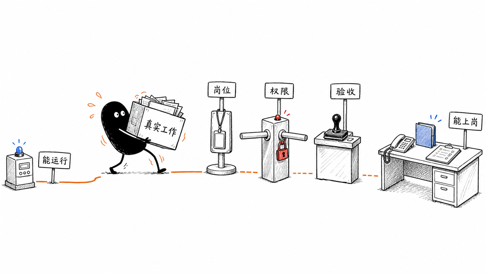
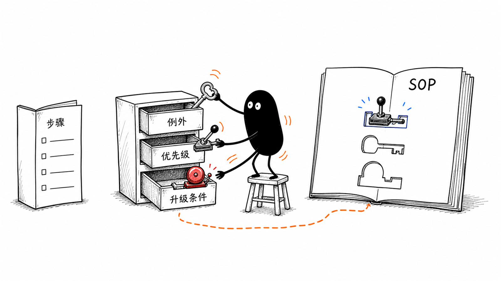
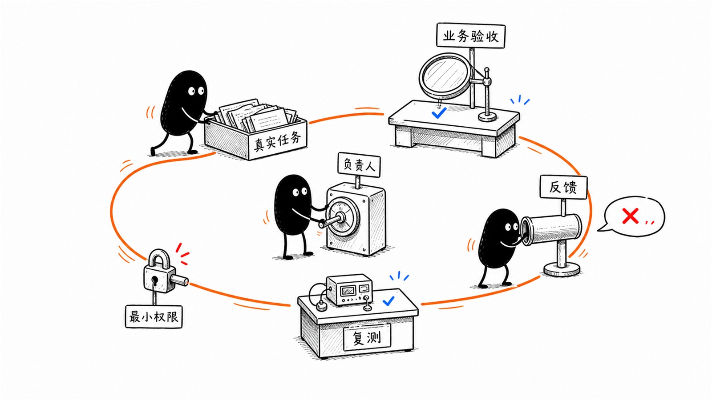
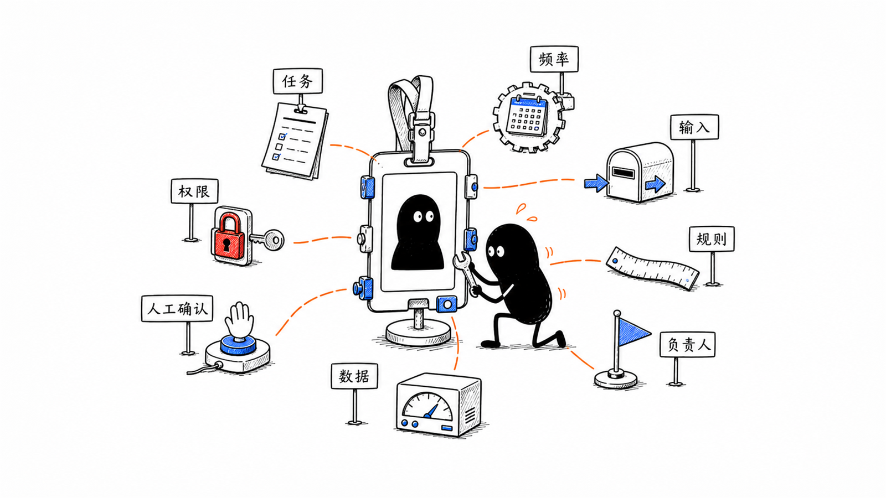

如果一家企业接入 Agent 后，只做了三件事：接上模型、写一段提示词、给员工开个账号，那它大概率很快就会得到一个结论：这东西不稳定，没想象中好用。

问题不一定先出在模型上。

这更像是招了一个新人，却没有告诉他具体岗位、工作目标、流程、权限和合格标准。带他看了两遍资料，聊了几次，就让他独立接客户、改数据、发消息。结果做错以后，管理者又说：这个人不行。

很多企业现在对 Agent 的用法，差不多就是这样。

我自己最近也一直在折腾这件事。我想把 Hermes、Radar、Obsidian 和几个 Agent 接起来，让它们帮我接任务、读知识库、盯进度，最后慢慢变成一个能持续推进事情的个人助手。可真正动手以后，我发现把工具接上并不算最难。更麻烦的是：它到底负责什么，能读哪些内容，做到哪一步算完成，出了问题又该由谁接手。

这套系统现在还在搭建和试用，并没有完全跑通。可做到这里，我已经有一个很明显的感受：这些问题说不清，Agent 看起来功能很多，真正敢交给它的事情却很少。

模型、工作流和工具当然重要，但这些只是数字员工的“大脑”和工作台。企业真正要完成的，是一套数字岗位的定义、训练和管理：先定岗位，再写 SOP，配置工具和权限，用真实任务培训，持续纠正，最后按业务结果验收。

顺序变了，Agent 落地才会从“装了一个新工具”，变成“公司里多了一个能承担具体工作的角色”。

## 一、先别急着问 Agent 能做什么，先把岗位定下来

很多 Agent 项目一开始就问：它能不能写内容、分析数据、跟进客户、做报表、回复消息？

这些能力它可能都有，但放在企业里，这个问题太大了。

一个真人员工入职时，也不会收到一句“你什么都帮公司做一点”。他会有岗位、职责、协作对象和工作结果。Agent 也一样。越想把它做成万能助手，它每天面对的输入、规则和输出就越混乱，最后什么都会一点，什么都不敢真正交给它。

更可行的做法，是先让它承担一个具体岗位中的一项高频任务。

比如做销售线索整理，不要一开始就让它负责“整个销售流程”。先让它每天读取新增线索，补齐固定字段，判断哪些信息缺失，把需要人工确认的内容标出来，再交给销售决定下一步怎么跟。

这个任务能不能交给 Agent，可以先看五件事：是不是反复发生，输入是否相对稳定，判断规则能不能说清，输出能不能验收，出错后能不能由人兜底。

五件事都说不清，问题通常还没有收缩到能做的程度。继续换模型、加提示词，只会把一个模糊需求做得更复杂。

## 二、真正难写的不是步骤，是人的隐性判断

岗位定下来以后，下一步通常是写 SOP。

很多企业已经有 SOP，但真正拿来训练 Agent 时，很快会发现它只写了“做什么”，没有写“怎么判断”。

比如销售线索进入系统后，SOP 可能写着：检查资料、判断意向、分配销售、安排跟进。看起来很完整，但里面最关键的部分都藏在员工脑子里：什么样的信息算完整，什么情况算高意向，哪些客户应该立刻联系，哪些内容涉及风险，出现冲突时听哪个字段。

真人员工可以靠经验、观察同事和不断追问补齐这些空白。Agent 不会自动知道公司内部默认的那套判断。

所以，给 Agent 写 SOP 不能只列操作步骤，还要把例外、取舍和升级条件写出来：

- 哪些情况可以直接处理；
- 哪些情况必须停下来问人；
- 两条规则冲突时优先哪一条；
- 信息不足时输出什么，而不是自己补全；
- 结果达到什么标准才算完成；
- 出现什么错误必须退回人工。

企业真正有价值的经验，往往就藏在这些“平时大家都知道”的细节里。把它们说清楚，不只是在训练 Agent，也是在重新整理企业自己的工作方法。

## 三、工具和权限，相当于数字员工的工作台和门禁

有了岗位和 SOP，Agent 还需要工具。

它要读取哪些系统，查哪些资料，往哪里写结果，是否允许发消息、改字段、触发下一步动作，这些都要提前定义。只让 Agent 对着一堆文档聊天，它最多是一个知识问答助手；让它调用 CRM、表格、知识库、邮件或内部接口，它才开始具备做事的能力。

但工具越多，风险也越大。

企业不会让一个刚入职的员工第一天就拿到所有客户数据、财务权限和管理员账号。数字员工也应该从最小权限开始：能只读就先只读，能生成待确认结果就先不直接执行，关键动作保留人工确认，所有操作留下记录，出了问题知道怎么撤回。

权限设计不能等到上线前再补。它本身就是岗位设计的一部分。

如果一个 Agent 需要十几个系统的高权限才能勉强工作，或者每次出错都会直接影响客户、资金和公司数据，这个场景可能就不适合作为第一个试点。

先让它在低风险、可检查的范围里把一件事做稳，价值通常比一开始追求全自动更大。

## 四、跑通一次，只能算完成了第一天培训

很多 Agent 演示看起来很顺：给一份材料，几分钟后生成一份结果，现场的人都觉得不错。

但演示成功和真实上岗之间，还有一段很长的距离。

真实工作里的输入不会永远整齐。客户名称可能写错，表格字段可能缺失，同一句话放在不同业务阶段含义不一样，员工也会临时改变流程。Agent 第一次跑通，只能证明这条链路在一个案例上能工作。

接下来要做的，更像带新人过试用期：

1. 找一批真实任务，不只用最干净的样例。
2. 让业务人员逐条验收输出，记录错在哪里。
3. 判断问题来自知识缺失、规则不清、工具异常，还是岗位本身没定义好。
4. 修改 SOP、Skill、知识和权限后，用同一批案例复测。
5. 再加入新的边缘情况，看它是不是只记住了上一道题。

这个过程会反复发生。今天新出现的客户问题、员工反馈和业务变化，都会变成下一轮训练材料。

所以 Agent 很难是一次性交付完成的产品。第一版做出来，只相当于新人办完了入职手续。什么时候能真正接活，要看它在真实任务里经历了多少次纠正，以及企业有没有人持续带它。

## 五、谁来带这个数字员工，往往比模型选型更重要

真人员工入职后有直属负责人，数字员工也需要。

这个人不一定会写代码，但要懂业务，能判断输出对不对，也有权决定规则怎么改。他要负责提供真实案例、解释例外、确认权限、组织试用和安排复盘。

如果业务部门只提一句需求，之后把项目全部交给技术人员，技术方就只能猜：这个字段是什么意思，什么结果算合格，员工为什么不用，出了错应该找谁。

反过来，如果技术已经把第一版做出来，业务人员却没有时间测试，也不愿意整理反馈，Agent 就会一直停在“看起来能用”的状态。

我自己的多 Agent 系统也踩过这个坑。起初总想让一个助手同时管任务、读知识、提醒进度、推进项目。后来才发现，任务状态、权限范围和完成标准没有提前定好，它确实可能做了事，做出来的却不是我真正要的结果。于是我开始把不同事务拆开，分别规定入口、权限和验收方式，再决定这个 Agent 是否值得长期保留。

一个能长期工作的 Agent，至少需要四类角色配合：老板或业务负责人定方向和红线；项目负责人管日常、权限和验收；技术方负责系统与工具；实际使用者提供真实流程和反馈。

这些角色不一定是四个人，但责任必须有人接住。否则，Agent 没有“师傅”，每次做错都只会变成一句模糊评价：还是不够智能。

## 六、考核 Agent，不能只看它有没有把结果生成出来

数字员工做得好不好，最终还得回到业务。

页面能打开、流程能运行、结果能生成，这些只能说明功能完成。企业更需要知道：真实员工有没有用，输出有没有被采用，后续动作有没有发生，原来的耗时、遗漏或风险有没有变化。

还是以销售线索整理为例，可以观察：每天处理了多少条线索，多少条需要人工退回，销售是否采用了它的分类，线索是否更快进入跟进，错误有没有造成额外返工。

如果 Agent 每天生成一份漂亮报告，却没人打开；或者它把客户信息整理得很完整，销售仍然不跟进，那它并没有真正进入业务。

这也是为什么项目开始前就要留下基线和验收方式。没有基线，最后只能靠“感觉好像省了时间”；没有负责人，发现问题后也没人决定继续、修改还是暂停。

考核不是为了证明 Agent 有多厉害，而是让企业知道这个数字岗位值不值得继续培养。

## 七、数字员工会换，企业积累下来的工作方法不能跟着丢

今天用这个模型，明天可能换另一个；今天从某个 Agent 平台进入，明天入口也可能变化。

真正应该留在企业里的，是岗位说明、SOP、Skill、知识库、工具接口、测试案例、权限记录和历史反馈。这些东西共同决定了数字员工怎样工作，也是企业在一次次纠正中积累下来的业务资产。

如果所有规则都只存在某个聊天窗口、某位开发者的提示词或某个平台的私有配置里，一旦换工具，前面的训练很可能又要重来。

把这些资产外置并持续更新，企业以后更换模型或 Agent 外壳时，才能保留已经形成的工作方法。这样培养的就不只是某一个工具，而是一套可以迁移、可以交接、可以继续迭代的数字岗位能力。

## 八、企业准备做 Agent，可以先写一张“数字员工岗位卡”

在讨论模型、平台和预算之前，先把下面八个问题写清楚：

1. 它具体承担哪个岗位里的哪一项任务？
2. 这项任务一周发生多少次，当前由谁完成？
3. 输入从哪里来，输出交给谁？
4. SOP 里有哪些隐性判断、例外和升级条件？
5. 它需要哪些工具和最小权限？
6. 哪些动作可以自动完成，哪些必须人工确认？
7. 谁负责训练、验收和持续修改规则？
8. 用什么数据决定继续、调整或停止？

这八个问题答不出来，先别急着开发。因为此时缺的可能不是更强的 Agent，而是企业还没有把这份工作本身讲清楚。

如果能答清楚，也不用一开始做得很大。挑一项高频、低风险、能验收、有人愿意配合的任务，让数字员工先完成一次真实工作，再带着它一轮轮修正。

这也改变了我看企业 Agent 项目的顺序。对我来说，一个 Agent 场景值不值得推进，排在前面的不再是模型和平台，而是这个数字岗位是不是真的存在：任务是不是高频，工作方式能不能说清，训练和验收分别由谁负责。

我更想做的，是陪企业把第一个数字员工真正带到岗位上，而不只是完成一次工具安装。

企业做 Agent 的门槛，正在被模型和工具快速降低。但数字员工能不能真正上岗，依然取决于那些很传统的管理动作：岗位有没有定义，经验有没有说清，权限有没有边界，结果有没有人验收。

工具可以很快接上，员工得慢慢带出来。
