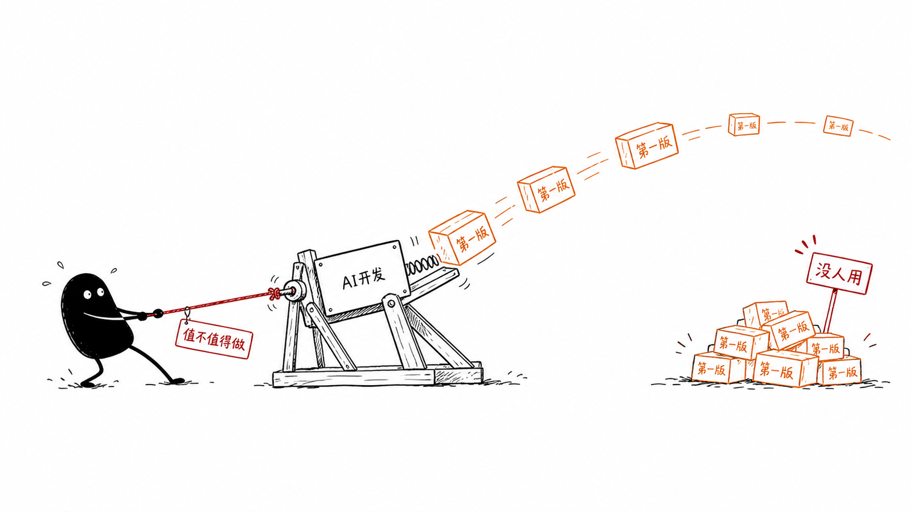
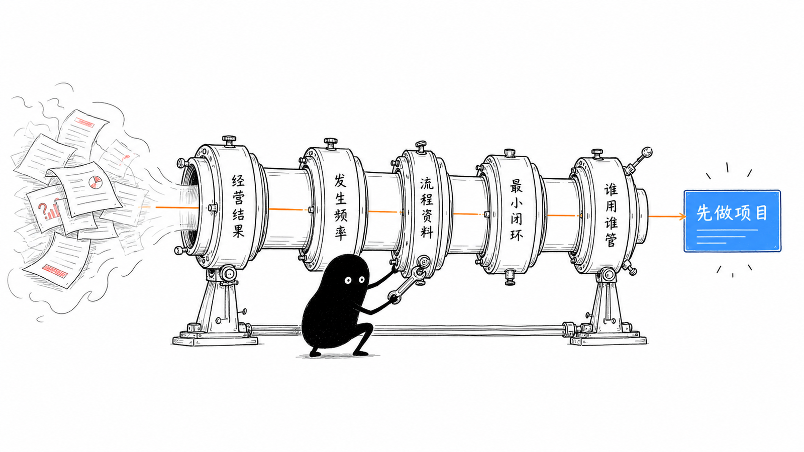
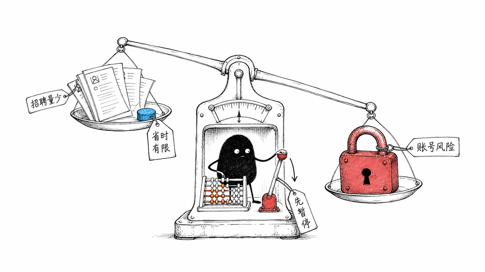
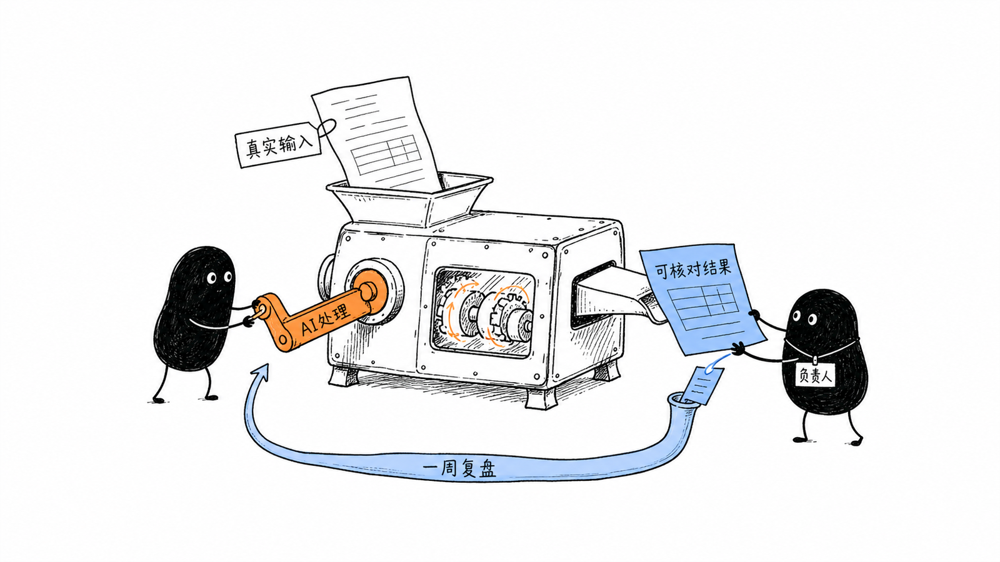

其实现在企业最不缺 AI 的落地场景，最缺的是判断哪一个值得先用 AI 去做。

以前企业做一套系统，首先担心的是能不能做出来：预算要多少、开发要多久、找的人靠不靠谱。

现在情况有点反过来了。

AI 已经能把第一版的开发周期压到几周，甚至几天。很多以前只能停留在 PPT 里的想法，现在都可以很快做出一个能点、能看的版本。

但“能做”变得容易以后，另一个问题反而更明显了：项目还没想清楚值不值得做，第一版就已经开始开发了。

7 月做完管理层 AI 分享后，我们一共梳理出了 4 个项目方向。其中两个没有继续，另外两个做出了第一版。后来，做出第一版的项目里，又有一个在准备上线前的培训时停了下来。

停下来的就是前面写过的那套 CRM。

它大约一周做出了第一个可运行版本，一个月迭代了 49 次。功能已经不少，原定的使用培训也排好了。可到了培训前，我们重新看了一遍实际业务，发现经销商手里本来就有接收客资的系统，只是没有认真使用，也没有持续跟进。

换一套新的 CRM，使用的人没有变，跟进责任没有变，原来的问题大概率还会再出现一次。所以培训取消了，C 端这部分也先停了下来。

以前系统开发的成本高、周期长，很多想法在报价和排期阶段就会被重新讨论。现在借助 AI，几天就可能做出第一版，这道门槛低了很多。成本确实低了，但企业也更容易跳过前面的判断，直接进入开发。

这几个方向推进一轮以后，“能不能做”在我这里已经被放到了后面。前面还有两个更重要的问题：为什么现在要做？做完以后由谁接着用？

技术上能做，和现在值得做，完全是两回事。

## 先别急着列功能

最近我在生财看到一个家具建材行业老板的复盘。

他花了 12 万元找人定制 ERP，前后开发了一年。系统上线一个月后，因为主流程跑不通、完成度低、后续修改还要继续排期，最后被他停掉了。

后来他借助 AI，自己重新做了一套系统，一个月完成第一版并投入使用。

这个案例很容易被理解成“老板应该自己学 AI 写系统”。但我觉得更值得看的，是他对自己公司业务的理解。

客资从哪里来，销售应该怎么跟，项目走到哪个节点容易出问题，成本应该怎么归集，这些判断都在他的脑子里。外部开发人员需要花很长时间理解，他自己却每天都在处理。

AI 可以缩短开发时间，却不会自动替企业选对问题。一个方向要不要进入开发，我觉得至少要先回答下面 5 个问题。

## 第一，这件事到底影响哪个经营结果？

“做一个 AI 助手”“搭一个智能体”“把流程自动化”，这些都不算业务目标。

继续往下问：它准备减少哪一笔损失，节省哪一段时间，提高哪一个转化，或者避免哪一种错误？

比如销售线索经常漏跟进，结果是已经花钱买来的客资被浪费；报价需要来回核对，结果是客户等待时间太长；项目成本只能结束后再算，结果是发现亏损时已经来不及处理。

到了这个程度，AI 项目才和生意发生关系。

如果去掉“AI”两个字以后，连问题本身都很难说清楚，那暂时还不需要讨论用什么模型、买什么工具。

## 第二，这个问题出现得够不够频繁？

有些事情很烦，但一个月只发生一两次。有些流程看起来不高级，却每天要消耗几个人的大量时间。

两者的优先级不一样。

我之前就做过一个 AI 简历筛选工具。它已经基本达到可用标准，为了降低风险，整个流程尽量只浏览候选人的公开信息，不自动沟通，也不做其他敏感操作，最多只是帮人事标记或收藏合适的候选人。

但公司当时的招聘需求并不大。

工具省下来的筛选时间有限，招聘平台账号被限制的风险却依然存在。人事不愿意承担这个风险，最后项目就停了。

如果换成每天要处理大量简历的企业，同一个工具的账可能完全不一样。节省下来的人力足够多，收益就可能大于风险。可在当时的招聘量下，风险反而排在了收益前面。

项目开始前，最好把几笔账算出来：这个问题一周发生多少次，每次占用多少人、多少时间，出错会造成什么损失，目前用什么办法勉强维持。

如果需求量很小，人工处理已经足够，专门开发一套系统未必划算。相反，一个动作每天重复几十次，即使第一版只节省其中一部分，也比较容易看出价值。

这一步不是为了把所有收益都算得特别准确，而是避免因为“技术上能做”，就把低频问题做成长期项目。

## 第三，流程、资料和判断标准现在在哪里？

很多企业一开口就想做智能分析，低头一看，数据还散在员工电脑、聊天记录和不同表格里。

同一件事，不同员工的做法不一样；哪些情况算完成，哪些结果需要返工，也没有统一标准。这时候直接接 AI，做出来的东西很难稳定。

有些项目的第一步不是智能化，而是先把资料收回来，把流程理清楚，把关键岗位的经验写出来。

至少要能拿出一份真实输入、一次最近发生的业务记录，以及一个可以核对结果的人。没有这些材料，AI 只能根据一段模糊描述猜企业想要什么。

这部分看起来没有生成页面那么直观，却决定了后面要返工多少次。

## 第四，第一版能不能只跑一个小闭环？

企业一旦开始谈系统，很容易把多年积累的问题一次性塞进去。

既要管理客户，又要管项目、绩效、审批、知识库和经营数据。功能越列越多，第一版迟迟看不到，等真正开始使用时，才发现最基础的流程方向就不对。

第一版可以更小一点：拿到一份真实输入，完成一次处理，交出一个业务人员能核对的结果，然后进入紧邻的下一步。

例如，先把不同渠道的客资自动整理进一张表，并分给对应销售；或者先根据固定规则生成一份报价，交给负责人确认。它们都不大，但从输入到结果是完整的。

小闭环的价值不只是开发快。更重要的是，几天或一两周之后，就能看到这个方向到底对不对，有没有人愿意接着用。

## 第五，做出来以后，谁使用，谁负责，怎么复盘？

这正是那套 CRM 最后暴露出来的问题。

公司原本就有工具，经销商却没有形成稳定的跟进动作。如果不重新确定使用要求、跟进责任和检查方式，再增加一个入口，只会多出一套需要维护的系统。

所以在开发之前，最好把三项信息写下来：哪个岗位从第二天开始使用，谁负责推动和处理问题，一周后由谁拿结果回来复盘。

还要写清楚复盘时看什么。是少录入了多少次，减少了多少遗漏，缩短了多少处理时间，还是某个业务节点终于能被查到？

只有“大家都来用一下”，没有负责人和检查结果，项目上线后的状态其实已经可以预见。

## 五个问题，决定项目现在走到哪一步

这 5 个问题不一定都能在第一次讨论里回答完整，但空白出现在哪里，下一步就应该先补哪里。

业务结果和发生频率说不清，先别立项；流程和资料没有准备好，先做调研和整理；小闭环拆不出来，继续缩小范围；使用人和负责人没有确定，先不要安排上线。

五个问题都有了比较具体的答案，再做第一版也不迟。

AI 把开发周期从几个月压到几周，甚至几天以后，企业更容易同时启动很多项目。可真正消耗时间的，往往是后面的沟通、数据、权限、培训、使用和维护。

下次再有人提出“能不能用 AI 做一个什么”，我会先找张纸，把这 5 个答案写下来，再决定要不要打开开发工具。

因为做错了项目，三天做完和三个月做完，区别只是更早拿到一个没人用的系统。

如果你的公司也准备上 AI，可以先挑出现在最想做的那个项目，把这 5 个问题逐项写一遍。哪一项最空，真正该先处理的通常就在那里。
