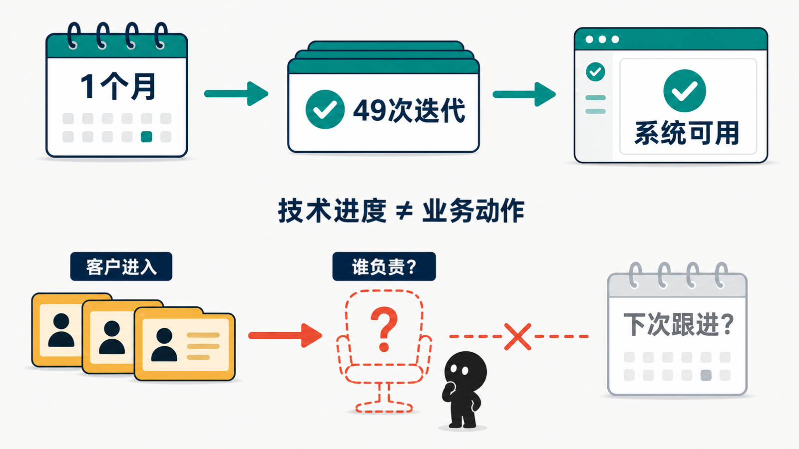
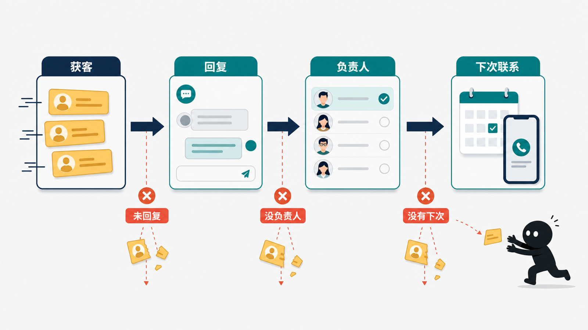
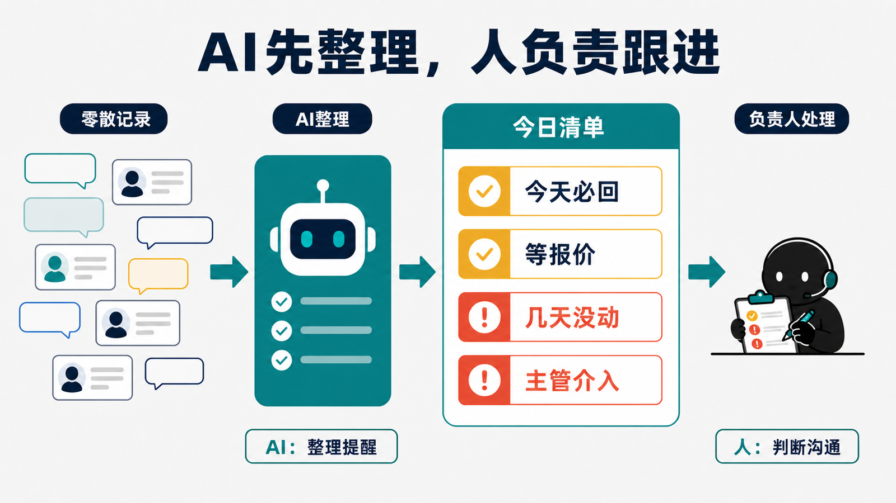
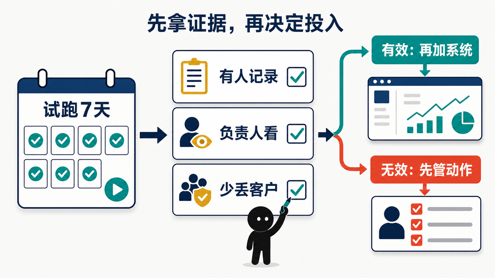

前段时间，我参与做了一套客户管理系统。

第一个能运行的版本大约用了一周，后来一个月里迭代了 49 次。原本已经准备给相关人员做培训，培训完就开始小范围使用，最后却被我停了下来。

不是系统不能用。真正让我停下来的，是公司原本就在用抖音自己的系统给经销商分发客户线索，但部分经销商收到以后没有认真跟，也没有形成稳定的使用习惯。

同一批人，面对现成系统都没有把客户跟下去。换成我们自己做的系统，可能只是多了一个需要登录的入口。

那次停下来以后，我看企业 AI 项目的顺序有了一点变化。

以前大家聊 AI，很容易先算能不能少招一个人，或者让现有员工多干一点活。这个账确实好算，一个岗位每个月多少工资，AI 工具一年多少钱，放在一起很快就有答案。

我现在会先看：公司每天有没有已经送到手边的客户，因为内部动作没有跟上，最后慢慢没了。

## 客户怎么没的，通常没人说得清

过去几年，我一直在家居行业接触获客、投放和客户跟进。前面不管是做短视频、直播，还是花钱投广告，目的都是把客户找过来。

可客户留下电话、加了微信或者进店问了一次，只能说明前面的获客做完了。后面谁来回、聊到了哪里、客户在犹豫什么、下次什么时候再联系，任何一步没接上，前面的钱都有可能白花。

这种损失通常很安静，安静到你几乎感觉不到。

客户不会专门告诉老板，自己是因为迟迟没人回复才去了别家。销售也不太可能主动统计，这个月有多少客户是自己忘记继续跟的。到了月底，老板能看到成交少了，却很难知道客户到底丢在了哪一步。

工资是每个月都能看到的明账，跟进过程中丢掉的客户不是。也正因为看不见，很多公司会继续把钱花在前面获客上，却很少回头检查，已经进来的客户到底有没有被接住。

## AI 先别替销售说话，先做一张每天有人看的清单

这类问题，我不太建议一开始就让 AI 自动联系客户。先让它做一件风险更低、也更容易检查的事：把销售已经聊过的客户整理出来，告诉负责人今天还有哪些人应该继续跟。

销售每次沟通完，不需要写一大段总结，只要留下几个最基本的信息：客户关注什么、现在卡在哪里、下一次什么时候联系。AI 再把这些零散记录整理成统一状态。

第二天，管理者看到的也不再是一堆聊天记录，而是一张能直接处理的名单：今天必须回复谁，谁已经几天没有新动作，谁还在等报价，哪几条线索需要主管介入。

这件事甚至不一定要先开发系统。表格、现有 CRM，或者一个简单的 AI 工作流都可以。先看看员工愿不愿意记录，负责人会不会每天打开这张名单，客户跟进有没有因此变得更及时。

如果这个动作都没有发生，功能做得再多也没有意义。

## 先看 7 天，答案可能就出来了

真想判断这件事值不值得做，可以先拿最近 7 天的客户记录看一遍。

每条线索从哪里来，什么时候第一次联系，聊完以后有没有下一步。先不用分析得多复杂，把这几个信息补齐，很多问题就会自己露出来。

有些公司可能会发现，真正卡住的不是销售不会说，而是客户进来以后根本没有明确负责人；有些是第一次回复很快，聊过一次以后就没人再管；还有一些连“多久必须联系客户”都没有说清楚。

这些问题还没弄明白，就急着买工具或者开发系统，最后很容易把原来的混乱原样搬进去。

可以先选一个销售、一个门店或者一小批客户试一周。AI 只负责整理和提醒，人继续负责判断和沟通。一周后再看，没人跟的客户有没有变少，管理者是不是不用逐个追问。

如果有效，再往 CRM、自动提醒和更完整的流程上加。如果员工连最基本的记录都不愿意留，负责人也不看每天的名单，那就先停下来处理管理问题。

回到前面那套迭代了 49 次的系统，继续做第 50 次并不难。真正没有答案的是，系统上线后的第二天，谁会打开它，谁会根据里面的记录继续联系客户。

对中小企业来说，第一个 AI 项目不一定要先证明能省掉一个人的工资。能让已经花钱找来的客户少丢几个，已经很接近生意本身。

如果连这张客户清单都没人看，就先别做第 50 个版本了。
